# Assignment 03 — Transfer Learning, Fine-Tuning, Hyperparameter Tuning, and Interpretability

**Student Name:** Faisal Ahmed  
**Student ID:** 1000128819  
**Course / Program:** Skills for Industry Competitiveness and Innovation Program (SICIP) — BRAC University  

---

## 1. Project Overview & Dataset Preparation

This repository implements an end-to-end toxic comment classification pipeline on the **Civil Comments** dataset ([`google/civil_comments`](https://huggingface.co/datasets/google/civil_comments)) across four required stages:
1. **Transfer Learning (Frozen Baseline):** Pre-trained `distilbert-base-uncased` with the transformer backbone frozen as a static feature extractor.
2. **End-to-End Fine-Tuning:** Unfreezing all 66.96M parameters with AdamW, linear warmup/decay, mixed precision (`FP16`), gradient clipping, and **early stopping**.
3. **Hyperparameter Tuning:** A 6-point grid search over learning rate and weight decay ranked by validation ROC-AUC, followed by a full-budget retrain with early stopping.
4. **Real-World Evaluation & Interpretability:** Out-of-distribution testing on 6 custom comments and token-level **Input-Gradient L2 Saliency** explanations across True Positive, True Negative, False Negative, False Positive, and real-world cases.

### Dataset & Binarisation Threshold
* **Loading:** Loaded directly via `load_dataset("google/civil_comments")` from the Hugging Face `datasets` library using the official `train` (`1,804,874` rows), `validation` (`97,320` rows), and `test` (`97,320` rows) splits.
* **Label Binarisation Threshold:** Continuous toxicity scores (`toxicity` $\in [0, 1]$) are converted into binary labels using a threshold of **`0.5`**:
  $$\text{label} = \begin{cases} 1 \text{ (toxic)} & \text{if } \text{toxicity} \ge 0.5 \\ 0 \text{ (not toxic)} & \text{if } \text{toxicity} < 0.5 \end{cases}$$
* **Class Imbalance & Balanced Subsampling:** Raw Civil Comments splits are heavily imbalanced (`8.00%` toxic in train, `7.88%` in validation, `7.99%` in test; mean toxicity $\approx 0.101–0.103$). Training a frozen linear head on an ~8% positive distribution risks collapsing into a trivial majority-class predictor. To ensure stable gradients and a controlled comparison across stages without cross-split leakage, we drew **50/50 class-balanced subsets** strictly from each official split:
  * **Train Subset:** `30,000` comments (`15,000` toxic / `15,000` not toxic)
  * **Validation Subset:** `7,500` comments (`3,750` toxic / `3,750` not toxic)
  * **Test Subset:** `7,500` comments (`3,750` toxic / `3,750` not toxic)
  * **Hyperparameter Search Subset:** `15,000` stratified training comments (`7,500` toxic / `7,500` not toxic), evaluated on the full `7,500` validation split.
* **Sequence Length & Truncation (`MAX_LENGTH = 128`):** In our 30,000-row training subset, comment word counts have a **median of `34.0` words**, a **90th percentile (`p90`) of `122.0` words**, and a **maximum of `311` words**. Because WordPiece subword tokenisation expands word counts by ~1.2x–1.3x, `MAX_LENGTH = 128` fully covers typical comments while truncating the longest ~10%–15% tail.

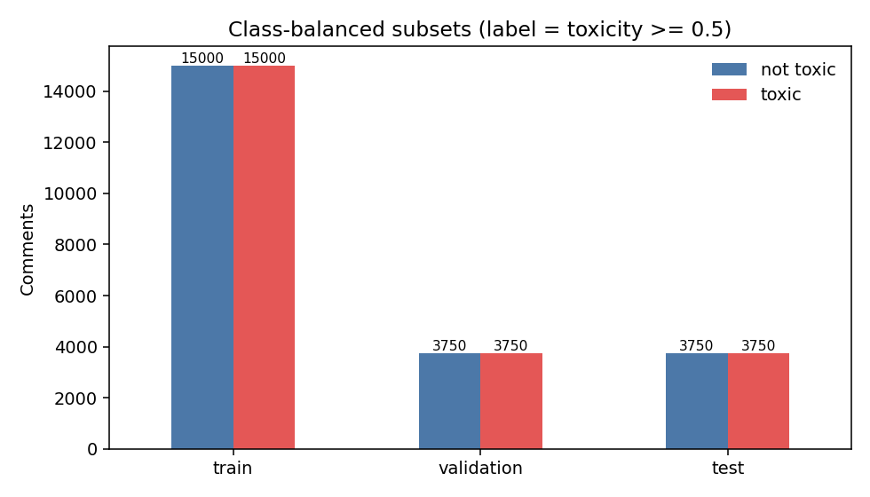

---

## 2. Model Choice: Why `distilbert-base-uncased`?

We selected **`distilbert-base-uncased`** (6 transformer layers, 768 hidden dimension, 12 attention heads, `66,955,010` total parameters) for the following reasons:
1. **Efficiency for Multi-Stage Experiments:** Knowledge distillation from `bert-base-uncased` retains ~97% of BERT's downstream language understanding performance while reducing parameter count by 40% and accelerating training/inference by ~60%. This makes running a 4-epoch frozen baseline, an end-to-end fine-tune, a 6-trial grid search, and a full-budget retrain feasible on a single Google Colab T4 GPU in ~22 minutes total.
2. **Clean Separation of Feature Extractor vs. Classification Head:** Hugging Face's `AutoModelForSequenceClassification` attaches `pre_classifier` ($768 \times 768$ linear layer + ReLU) and `classifier` ($768 \times 2$ linear projection) containing **`592,130` trainable parameters (`0.88%`)** on top of the `distilbert` encoder (`66,362,880` parameters). In Stage 1, freezing `model.distilbert` and keeping it in `.eval()` mode (to prevent encoder dropout noise on fixed features) provides a rigorous linear-probe transfer learning baseline.

---

## 3. Experimental Comparison: Without Tuning vs. With Tuning

### 3.1 Held-Out Test Set Results ($N = 7,500$ Balanced Test Split)

| Pipeline Stage | Trainable Params | Learning Rate | Weight Decay | Best Val Epoch (Early Stop) | Val-Chosen Threshold | Test Accuracy | Test Precision | Test Recall | Test F1 (Calibrated) | Test F1 (@ 0.5) | Test ROC-AUC | Test PR-AUC | Time (min) |
| :--- | :---: | :---: | :---: | :---: | :---: | :---: | :---: | :---: | :---: | :---: | :---: | :---: | :---: |
| **1. Frozen Baseline** | 592,130 (0.88%) | `1e-3` | `0.01` | Epoch 4 (`val_f1=0.7902`) | `0.35` | `0.7628` | `0.7056` | `0.9019` | `0.7918` | `0.7908` | `0.8692` | `0.8584` | `3.44` |
| **2. Fine-Tuned (Default)** | 66,955,010 (100%) | `2e-5` | `0.01` | Epoch 1 (`val_f1=0.8826`, stopped Ep 2) | `0.50` | `0.8801` | `0.8529` | `0.9187` | `0.8846` | **`0.8846`** | `0.9505` | `0.9497` | `4.23` |
| **3. Fine-Tuned + Best Search HP** | 66,955,010 (100%) | `5e-5` | `0.01` | Epoch 2 (`val_f1=0.8804`, stopped Ep 3) | `0.30` | **`0.8805`** | **`0.8530`** | **`0.9195`** | **`0.8850`** | `0.8839` | **`0.9523`** | **`0.9515`** | `6.33` |

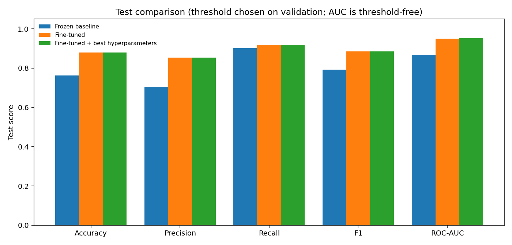

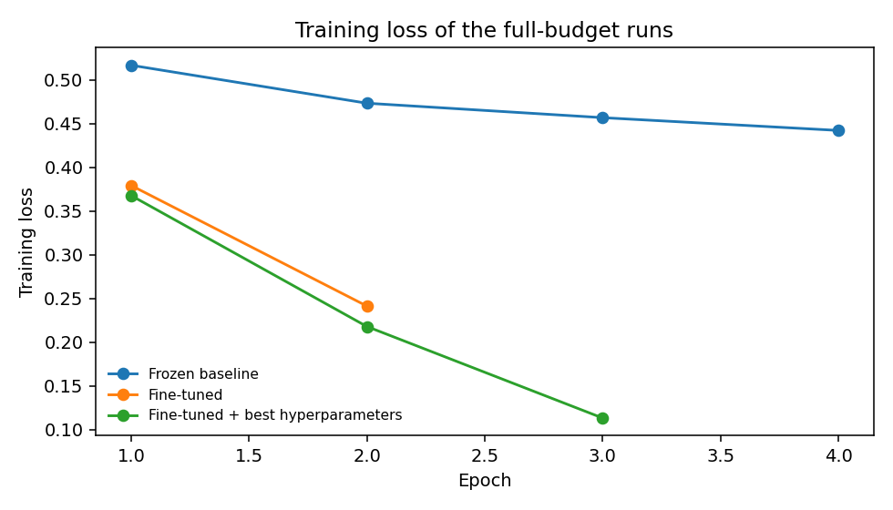

### 3.2 Hyperparameter Tuning Results & Screenshot

We performed a 6-point grid search over **learning rate** $\in \{1\text{e-}5, 2\text{e-}5, 3\text{e-}5, 5\text{e-}5\}$ and **weight decay** $\in \{0.0, 0.01\}$. Each trial was trained for `1` epoch on the `15,000`-row stratified search subset and ranked by **Validation ROC-AUC** (threshold-free ranking quality) on the `7,500`-row validation split:

| Rank | Learning Rate (`lr`) | Weight Decay (`wd`) | Validation ROC-AUC | Validation F1 (@ 0.5) | Validation Precision (@ 0.5) | Validation Recall (@ 0.5) | Trial Time (min) |
| :---: | :---: | :---: | :---: | :---: | :---: | :---: | :---: |
| **1** | **`5e-5`** | **`0.01`** | **`0.947279`** | **`0.878923`** | **`0.862237`** | **`0.896267`** | `1.28` |
| **2** | `5e-5` | `0.00` | `0.947185` | `0.878317` | `0.861318` | `0.896000` | `1.27` |
| **3** | `3e-5` | `0.01` | `0.945214` | `0.874527` | `0.856741` | `0.893067` | `1.28` |
| **4** | `2e-5` | `0.00` | `0.941789` | `0.870782` | `0.854466` | `0.887733` | `1.27` |
| **5** | `2e-5` | `0.01` | `0.941716` | `0.871090` | `0.855307` | `0.887467` | `1.28` |
| **6** | `1e-5` | `0.01` | `0.929759` | `0.853849` | `0.848565` | `0.859200` | `1.28` |

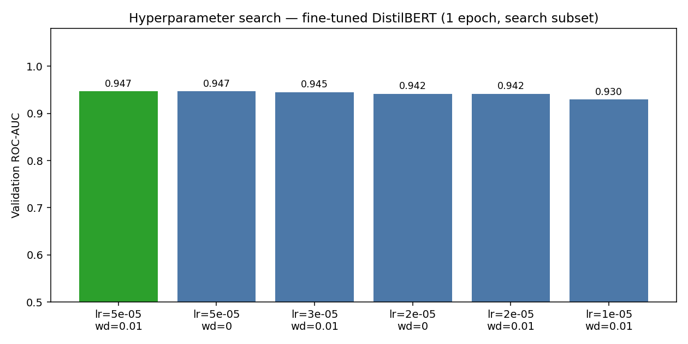

### 3.3 Justification of Results Without Tuning and With Tuning
1. **Why Unfreezing the Backbone (Stage 2 vs. Stage 1) Yields a Massive Gain (`+0.0813` ROC-AUC, `+0.0928` F1):**
   * The **Frozen Baseline** (`ROC-AUC = 0.8692`, `F1 = 0.7918`, `Precision = 0.7056`) only trains a shallow classification head on top of static pre-trained MLM representations. Because pre-trained BERT embeddings group words by general topical and syntactic similarity rather than conversational hostility, a static linear boundary suffers from a high false-positive rate on emphatic non-toxic comments.
   * **End-to-End Fine-Tuning** (`lr = 2e-5, wd = 0.01`) adapts all 6 transformer layers to task-specific toxicity cues, boosting Test Precision by `+14.73%` (`0.7056` $\rightarrow$ `0.8529`), Test Accuracy by `+11.73%` (`0.7628` $\rightarrow$ `0.8801`), and Test ROC-AUC to `0.9505`.
2. **Why Hyperparameter Tuning + Early Stopping Improved ROC-AUC to `0.9523` (and Why Stage 2 & Stage 3 Are Nearly Tied):**
   * Under a 1-epoch search budget on 15,000 samples, a higher learning rate (`lr = 5e-5`) converges fastest and ranked #1 (`val_roc_auc = 0.9473`). The top two trials (`wd = 0.01` vs `wd = 0.0` at `lr = 5e-5`) differed by only `0.000094` validation ROC-AUC, indicating that learning rate dominates weight decay over short horizons.
   * When retraining on the full 30,000 training subset, **Early Stopping (`patience = 1` on `val_f1@0.5`)** was critical: the default `2e-5` model peaked at Epoch 1 (`val_f1 = 0.8826`) and stopped after Epoch 2, whereas the `5e-5` model improved through Epoch 2 (`val_f1 = 0.8804`, `val_roc_auc = 0.9504`) before beginning to overfit at Epoch 3 (`train_loss = 0.1132`, `val_f1 = 0.8740`), triggering early stopping and restoring Epoch 2.
   * On the test set, the tuned model (`lr = 5e-5, wd = 0.01`) achieved the highest **Test ROC-AUC (`0.9523` vs `0.9505`)** and **calibrated Test F1 (`0.8850` vs `0.8846`)**, while the default `2e-5` model was `0.0007` higher on uncalibrated `F1@0.5` (`0.8846` vs `0.8839`). Because gaps of `0.0004–0.0018` fall within single-seed variance, both fine-tuned models perform at virtually the same ceiling—demonstrating that `2e-5` is already a strong default and that early stopping prevents late-epoch degradation.
3. **Selection Criteria & Evaluation Limitations (50/50 Test Split vs. ~8% Natural Toxicity):**
   * **Selection Protocol:** Grid trials are ranked by validation `ROC-AUC`; epoch checkpoints and early stopping track validation `F1@0.5`; final decision thresholds (`0.35`, `0.50`, `0.30`) are chosen via a validation F1 sweep with zero test leakage.
   * **Confusion Matrix & Base-Rate Caveat:** On the 7,500-row balanced test set, the tuned model produced `TN = 3,156`, `FP = 594` (`FPR = 15.84%`), `FN = 302` (`FNR = 8.05%`), and `TP = 3,448`. Because our test set is 50% toxic whereas real-world Civil Comments traffic is ~8% toxic, test precision (`0.8530`) is inflated relative to deployment. In production (~92% non-toxic), a 15.84% false-positive rate would lower precision, requiring a stricter probability threshold (e.g., `>= 0.75`) or PR-AUC calibration on an unstratified validation set.

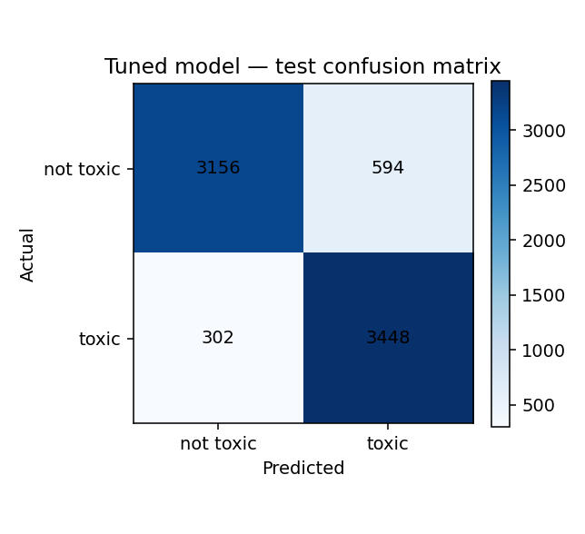

---

## 4. Test on Real-World Text

We evaluated the tuned fine-tuned model (`threshold = 0.30`) on 6 custom sentences written outside the Civil Comments dataset to test out-of-distribution generalisation:

| # | Input Text | Expected Class | Predicted Class | `P(toxic)` | Agrees? | Short Check of Prediction |
| :-: | :--- | :---: | :---: | :---: | :---: | :--- |
| **1** | `"You are an idiot and nobody wants you here. Shut up already."` | `toxic` | **`toxic`** | `0.9948` | ✅ Yes | Direct personal insult (`idiot`) plus a hostile demand to leave/stop speaking. Correctly flagged with 99.5% confidence. |
| **2** | `"I disagree with this proposal, but the cost table is useful. Could you share the source for the 12 percent figure?"` | `not toxic` | **`not toxic`** | `0.0024` | ✅ Yes | Polite disagreement and constructive factual inquiry without insults. Correctly classified as civil (`0.002`). |
| **3** | `"These immigrants are vermin and do not belong in this city."` | `toxic` | **`not toxic`** | `0.0858` | ❌ No | **Hard Failure Case:** Dehumanising group attack using the metaphor `vermin` inside formal syntax. Because it lacks common conversational profanity/slurs, the model assigns `P(toxic) = 0.086` (above civil comments' `0.002`, but below the `0.30` cutoff), highlighting a known lexical blind spot for metaphorical hate speech. |
| **4** | `"Thank you for the careful write-up. The timeline made the argument much easier to follow."` | `not toxic` | **`not toxic`** | `0.0020` | ✅ Yes | Appreciation and specific positive feedback. Correctly classified as not toxic. |
| **5** | `"This pathetic loser ruined the whole meeting and should get lost."` | `toxic` | **`toxic`** | `0.9952` | ✅ Yes | Direct personal attack (`pathetic loser`, `get lost`) aimed at an individual. Correctly flagged as toxic. |
| **6** | `"Oh wonderful, another delay. Exactly what everyone was hoping for."` | `not toxic` | **`not toxic`** | `0.0027` | ✅ Yes | Dry sarcasm expressing annoyance at a delay, with no slur, profanity, or personal attack. Correctly classified as not toxic. |

---

## 5. Interpretability Analysis

### Which Explainability Method Was Used, and Why?
We used **Input-Gradient L2 Saliency** ($\|\nabla_{\mathbf{e}_i} z_{\hat{y}}\|_2$). For a given input comment, we pass the input embeddings $\mathbf{e}_i \in \mathbb{R}^{768}$ (`word_embeddings + position_embeddings + LayerNorm`) into DistilBERT, backpropagate the predicted class logit $z_{\hat{y}}$ with respect to $\mathbf{e}_i$, and compute the Euclidean (L2) norm of each token's gradient vector. Subword pieces (`##...`) are merged into whole words via their maximum gradient norm and normalized to $[0, 1]$.

* **Why Input-Gradient Saliency?** Unlike raw self-attention weights—which are not materialised by default in PyTorch's fused SDPA (`scaled_dot_product_attention`) kernel and often reflect syntactic bookkeeping (attending to `[CLS]`, punctuation, or function words)—input-gradient saliency directly measures the local first-order sensitivity of the classifier's decision logit to small perturbations in each word's embedding.
* **Methodological Limitation:** Because L2 norms are unsigned ($\ge 0$), saliency shows *magnitude of sensitivity* rather than *signed polarity* (whether a token pushes the logit toward toxic or not-toxic).

### Explainability Analysis of Selected Predictions

#### 1. Correct Toxic Prediction (True Positive — Test Set)
* **Text:** `"Stupid is as stupid does."`
* **Prediction:** `toxic` (`P(toxic) = 0.996`) | **Dataset Label:** `toxic`
* **Strongest Gradient Tokens:** `stupid`, `stupid`, `as`, `does`, `.`, `is`
* **Analysis:** The gradient norm is overwhelmingly concentrated on the two occurrences of the insult adjective `stupid`, confirming that the classifier's high-confidence toxic prediction is driven directly by the derogatory keyword.

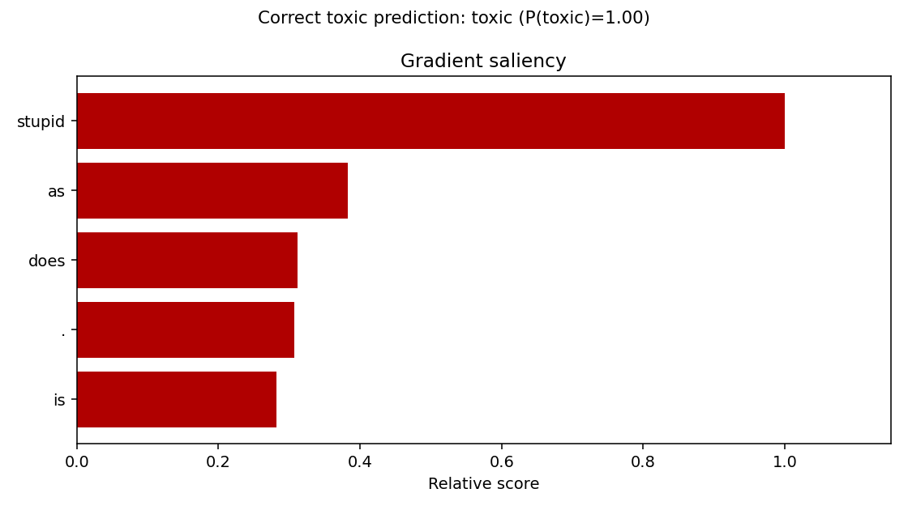

#### 2. Correct Not-Toxic Prediction (True Negative — Test Set)
* **Text:** `"Do you have a source to support your claim that profit is not included in that number? I'll wait."`
* **Prediction:** `not toxic` (`P(toxic) = 0.002`) | **Dataset Label:** `not toxic`
* **Strongest Gradient Tokens:** `profit`, `wait`, `.`, `that`, `source`, `claim`, `support`, `included`
* **Analysis:** Even though the comment challenges another user (`"I'll wait"`), there are no insult or profanity tokens. Saliency is spread evenly across substantive debate nouns and verbs (`profit`, `source`, `claim`, `support`), keeping `P(toxic)` near zero.

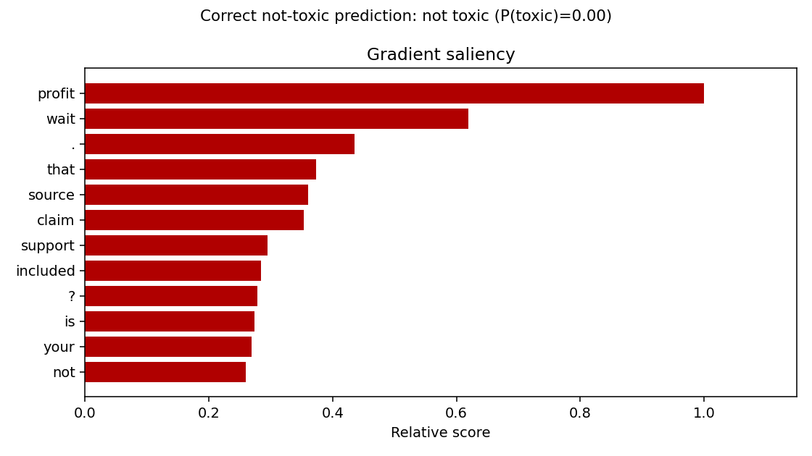

#### 3. False Negative (Missed Toxicity — Test Set)
* **Text:** `"I agree, although in this case I would recommend revenge."`
* **Prediction:** `not toxic` (`P(toxic) = 0.003`) | **Dataset Label:** `toxic`
* **Strongest Gradient Tokens:** `revenge`, `recommend`, `case`, `.`, `agree`, `would`, `although`, `,`
* **Analysis:** Saliency reveals that `revenge` is indeed the single most sensitive token in the sentence (`1.00` relative score), followed by `recommend`. However, because the sentence is framed in polite, measured phrasing (`"I agree, although in this case I would recommend..."`) without any profanity or personal slur, the single word `revenge` is not enough to push the toxic logit past the threshold.

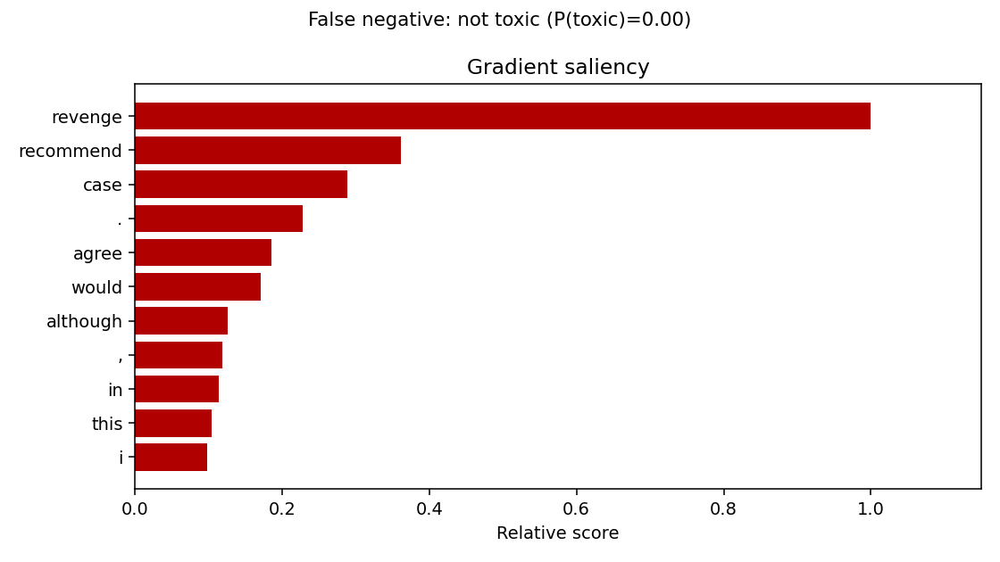

#### 4. False Positive (Over-Flagged Civil Comment — Test Set)
* **Text:** `"Damn right"`
* **Prediction:** `toxic` (`P(toxic) = 0.993`) | **Dataset Label:** `not toxic`
* **Strongest Gradient Tokens:** `damn`, `right`
* **Analysis:** Saliency is 100% locked onto `damn` (`1.00` vs `0.21` on `right`). In idiomatic English, `"Damn right"` is an emphatic expression of agreement (correctly labelled `not toxic` by human annotators), but in a 2-word context the model over-relies on the lexical presence of the mild swear word `damn`.

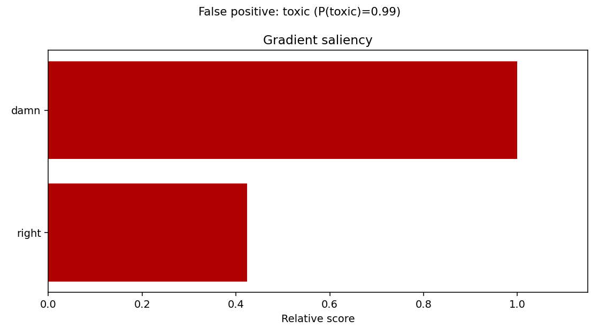

#### 5. Real-World Comment (Expected Toxic)
* **Text:** `"You are an idiot and nobody wants you here. Shut up already."`
* **Prediction:** `toxic` (`P(toxic) = 0.994`)
* **Strongest Gradient Tokens:** `idiot`, `an`, `are`, `shut`, `you`, `and`, `nobody`, `you`
* **Analysis:** The model focuses sharply on the explicit insult `idiot` and the hostile imperative `shut`, matching human intuition.

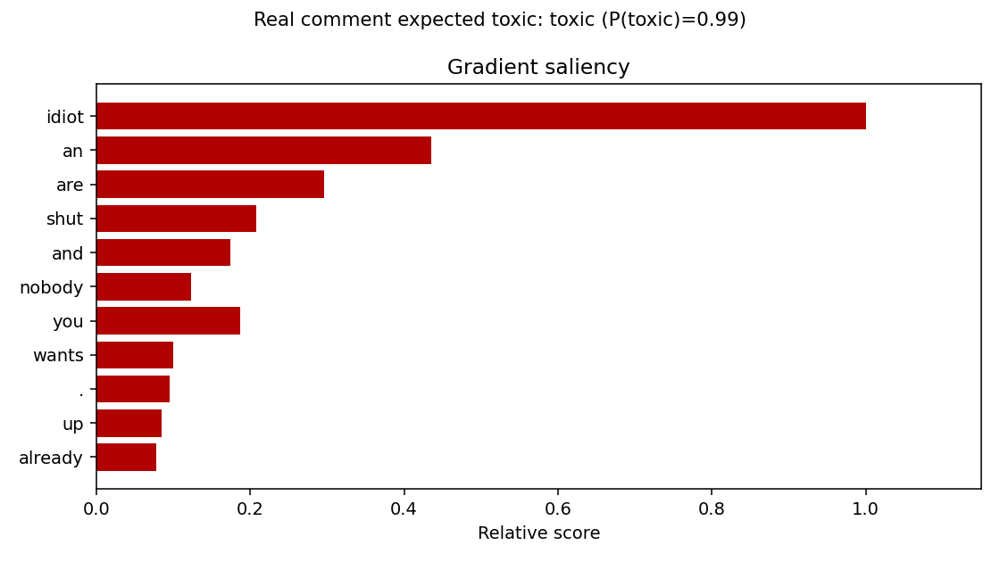

#### 6. Real-World Comment (Expected Not Toxic)
* **Text:** `"I disagree with this proposal, but the cost table is useful. Could you share the source for the 12 percent figure?"`
* **Prediction:** `not toxic` (`P(toxic) = 0.002`)
* **Strongest Gradient Tokens:** `percent`, `proposal`, `table`, `12`, `cost`, `useful`, `disagree`, `figure`
* **Analysis:** Sensitivity is distributed across neutral analytical vocabulary (`percent`, `proposal`, `table`, `cost`, `disagree`), verifying that explicit disagreement (`disagree`) does not trigger false-positive toxicity when expressed constructively.

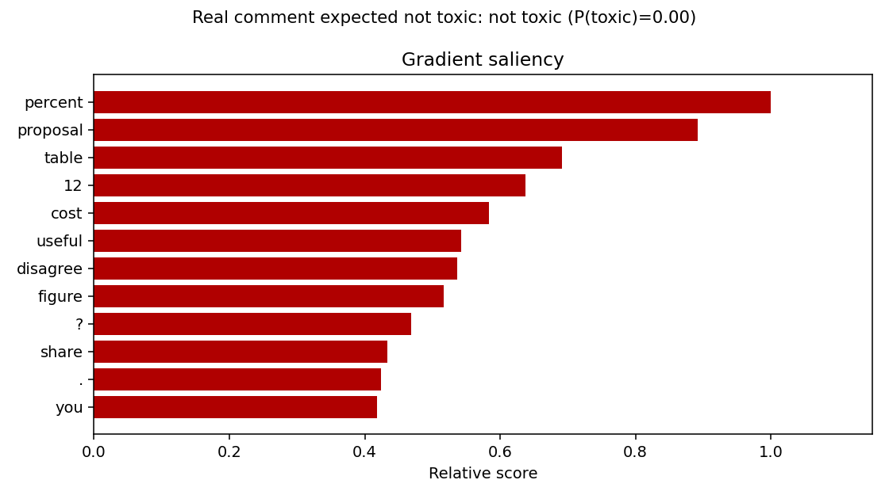

---

## 6. Repository Structure & Reproducibility

```text
├── Assignment_03_Final_Clean.ipynb   # Complete end-to-end Jupyter Notebook pipeline
├── README.md                         # Technical report with student name, ID, and analysis
├── figures/                          # Saved plots generated by the notebook
│   ├── class_balance.png
│   ├── tuning_results.png
│   ├── model_comparison.png
│   ├── loss_curves.png
│   ├── confusion_matrix.png
│   ├── explain_correct_toxic_prediction.png
│   ├── explain_correct_not_toxic_prediction.png
│   ├── explain_false_negative.png
│   ├── explain_false_positive.png
│   ├── explain_real_comment_expected_toxic.png
│   └── explain_real_comment_expected_not_toxic.png
├── tuning_results.csv                # 6-point hyperparameter grid search log
├── metrics_comparison.csv            # Final test set comparison across all 3 stages
├── real_world_predictions.csv        # Predictions on the 6 real-world test comments
└── results_summary.json              # Full training history and evaluation metrics